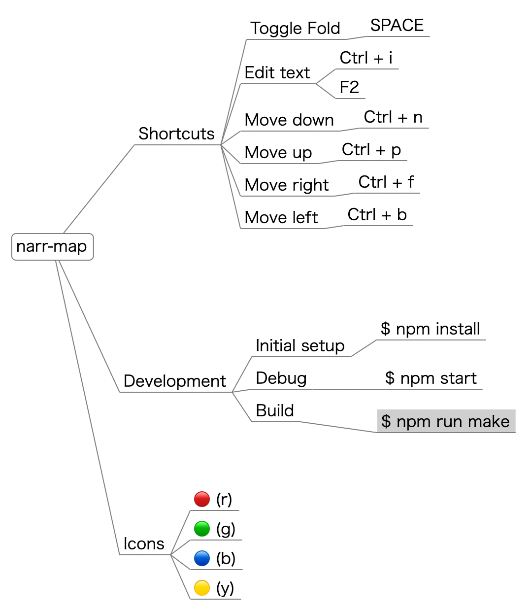

# narr-map

An intuitive and user-friendly mind map editor with a FreeMind-compatible interface.



## Key Features

- 🎯 **Intuitive Operation**
  - Drag & drop node movement
  - Easy selection and editing with mouse and keys

- ⌨️ **Rich Shortcuts**
  - Add nodes (Enter, Tab)
  - Toggle node folding (Space)
  - Cursor movement (Ctrl+n/p/f/b)
  - Text editing (Ctrl+i, F2)

- 🚀 **Advanced Features**
  - AI-powered auto-completion (Cmd+m, requires OpenAI API key)
  - PlantUML/YAML export
  - Copy mind map content to clipboard as YAML (Ideal for ChatGPT prompts)
  - Dark mode support

- 🎨 **Customization**
  - Icon support (red, green, blue, yellow circles)
  - Node folding functionality
  - Drag-based node positioning


## Downloads

- [MacOSX (Apple Silicon)](https://github.com/miyosuda/narr-map/releases/download/v0.1.1/narr-map-darwin-arm64-0.1.1.zip)

## Icons

| Text | Icon    |
| ---- | ----  |
| (r)  | :red_circle:   |
| (g)  | :green_circle:  |
| (b)  | :large_blue_circle:   |
| (y)  | :yellow_circle:  |


## Shortcuts

| Key | Function |
| ---- | ----  |
| Enter   | Add sibling node |
| Tab     | Add child node |
| Space   | Toggle fold |
| Ctrl+i  | Edit text |
| Ctrl+n  | Move down |
| Ctrl+p  | Move up |
| Ctrl+f  | Move right |
| Ctrl+b  | Move left |
| F2      | Edit text |
| Cmd+m | Auto-complete blank node (requires OpenAI API key) |
| Ctrl+Y | Copy mind map content to clipboard as YAML |


## Use from an MCP client

The app includes an MCP server. Keep narr-map open, copy its connection settings, and paste them into your MCP client. You do not install Node.js or clone this repository. The open map is what the client reads and edits.

### Connect

1. Start narr-map and leave it running.
2. In the narr-map menu, choose **Copy MCP Configuration**.
3. Paste the copied JSON into your MCP client's server settings.

The paths in the JSON are filled in for the app you are running. They look like this:

```json
{
  "mcpServers": {
    "narr-map": {
      "command": "/Applications/narr-map.app/Contents/MacOS/narr-map",
      "args": ["/Applications/narr-map.app/Contents/Resources/mcp.cjs"],
      "env": {
        "ELECTRON_RUN_AS_NODE": "1"
      }
    }
  }
}
```

### Pin nodes, then ask

1. Right-click a node and choose **Add to topic**. The node's underline turns red, and a chip appears at the top of the window. Click a chip to select that node. **×** removes it from the topic.
2. In the MCP client, refer to the pinned nodes as "these two" or "the topic". To add children under a heading that is already on the map, name that heading.

Example: pin "Budget" and "Schedule", then ask "Add three decisions to make first for these two, as children of Review."

Added nodes can be undone in narr-map.


## Development

### Initial Setup

```bash
$ npm install
```

### Debug

```bash
$ npm start
```

### Build

MacOSX arm64

```bash
$ npm run make -- --arch=arm64
```

MacOSX intel

```bash
$ npm run make -- --arch=x64
```

### Test

```bash
$ npm run test
```
